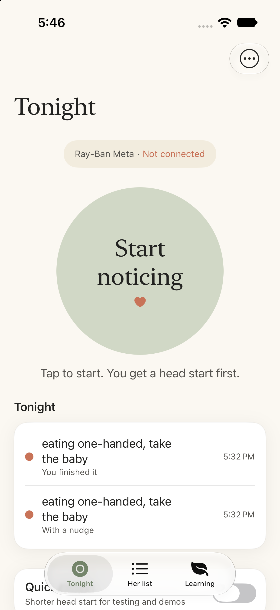
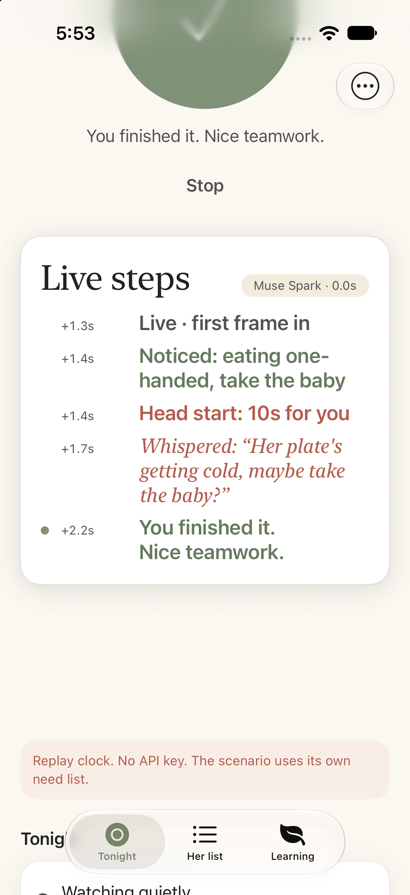
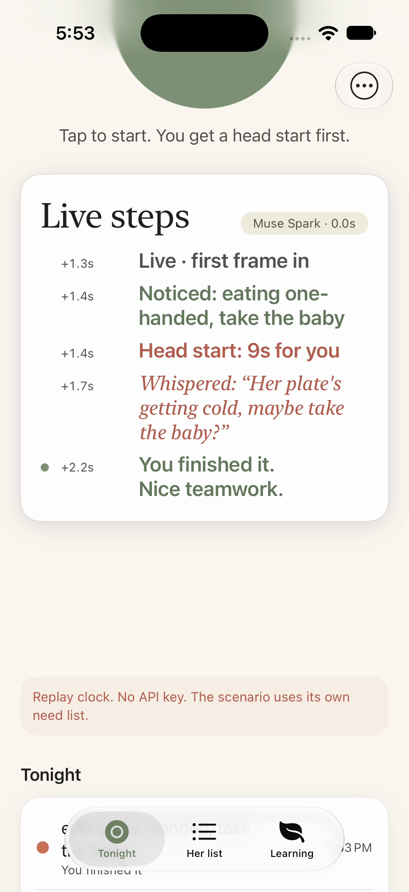

# Noticer

Noticer helps a new dad notice what his partner needs before she has to ask.

Mom writes a short list of everyday needs (take the baby, refill my water). Dad wears Ray-Ban Meta glasses. When the glasses spot one of those needs, he gets a head start to notice on his own, then a whispered cue if he doesn't. As he learns, the cues fade out.

Built for the Meta Global AI Developer Hackathon ("Build for Your World").

## How it works

- The glasses stream camera frames to an iPhone app.
- An on-phone signal gate (luma motion and Laplacian sharpness, no on-device model) picks keyframes and decides when a strip is worth sending.
- The need engine keeps those keyframes and asks Muse Spark on a slow cadence when nothing is open, and on the 8 second heartbeat when a need is open. One call is in flight at a time.
- Muse Spark reads that strip against mom's list. It reports whether the partner is in view and whether his hands are visible or busy, and it may request a latch, a deferral, or a self-notice.
- The phone owns the 90 second head start. It whispers only if he misses it, and the cue fades as he catches the need himself.

## Replay without an account

No API key, no glasses, and no clip. From this repo:

```sh
swift test
swift run noticer-replay
swift run noticer-replay --scenario take-baby-whisper
swift run noticer-replay --list
```

`noticer-replay` plays `fixtures/scenarios` through the same pipeline as the phone: replay frames, a scripted signal gate, `NeedEngine`, recorded model responses, then a cue speaker. The clock jumps, so the head start does not take 90 wall-clock seconds. A pass means the whisper fires at the head start, or a self-catch raises mastery and stays quiet. The two needs are `take-baby` (one-handed eating) and `refill-water` (nursing without water). The scripted gate does not need an API key. Its people preset stands in for the live luma decision and still feeds the visitor rule.

The iPhone app's Replay mode runs those same scenarios. A clip in `fixtures/clips` is optional and still goes through the engine.

`ReplayModelClient` can also serve `fixtures/model-responses` by request fingerprint. `RecordedModelClient` plays a fixture list in order. Neither reads a key.

## Demo mode

On the phone, open Settings from the tab menu, then Developer, and turn on Demo mode. The toggle caption is "Shows each step on screen in big type, for screen recordings." While a session runs, each pipeline step shows in large type so a screen recording can follow the loop. The strip stays up after Stop until Demo mode is turned off.

In Replay the model-time chip reads `Muse Spark · 0.0s`, because no live model call happens. The row times still follow the session clock.





[Ten-second demo clip](docs/demo-strip/demo-clip10.mp4)

## Record a live response

From a machine that has a key. This does not run in CI.

```sh
export META_API_KEY=...   # never commit this
swift run noticer-gate-g0 --record fixtures/model-responses
```

`--record` writes one JSON file per request fingerprint. The file stores the normalized verdict and the HTTP body, not the JPEG bytes. Replay can then serve that file with no key. Flags are listed by `swift run noticer-gate-g0 --help`.

## Architecture

```
Ray-Ban Meta Gen 3  -- DAT camera, 2 fps, glasses speaker
        |  FrameSource          DATFrameSource | ReplayFrameSource
        v
Signal gate             luma motion + sharpness on iOS | scripted gate in replay
        |  FrameGateSnapshot   (no on-device person or hand model)
        v
Need engine             keyframe selection (NeedEngine)
        |  Keyframe strip + Need list
        v
ModelClient             Muse Spark chat completions | recorded scenario | replay
                        partner_in_view, wearer hands, one tool
        |  ModelVerdict   (one tool + SceneAssessment; tool_calls wins over content)
        v
Need engine             head start, caps, mastery, caught_himself
        |  Cue            HardCapGate sees the same 15s extension step
        v
CueSpeaker              GlassesCueSpeaker | RecordingCueSpeaker
```

`Clock` is injected so tests move the head-start window without sleeping.

The phone owns timing and the hard caps. A model tool call is a request. Baseten is a second `ModelClient` backend and is out of scope: selecting it throws, and no request is built. Frames stay in memory. The Meta API key comes from the `META_API_KEY` environment variable or, later, the app's settings. It is not in the repo.

Live calls go to `POST https://api.meta.ai/v1/chat/completions` with model `muse-spark-1.3`, `tool_choice: auto`, and `parallel_tool_calls: false`. `reasoning_effort: none` is not a candidate. A `tool_calls` body may also contain a content string. The parser keeps the tool.

## Track boundaries

Three tracks can work in parallel. Folder ownership and the contract files they should not edit are in [CONTRIBUTING.md](CONTRIBUTING.md).

| Track | Owns |
| --- | --- |
| Core logic | Need list, glance latch, mastery, `caught_himself`, stale need, visitor rule, in `NoticerCore/Engine` |
| Agent layer | Muse Spark chat completions, the 5 tool handlers, hard caps, record and replay, in `NoticerAgent` |
| iOS app | DAT camera, signal gate, speech cues, phone UI, in `ios/` |
| Integration | `SessionPipeline`, scenario fixtures, the replay command. Glue only. It does not rewrite the engine or the client. |

`NoticerAgent` depends on `NoticerCore`. `NoticerPipeline` depends on both. The iOS app depends on all three. Core does not depend on the agent or on Apple frameworks, so `swift test` runs on Linux.

## Repository layout

```
Package.swift
Sources/NoticerCore/          shared types, protocols, need engine
Sources/NoticerAgent/         Muse Spark client, caps, record and replay
Sources/NoticerPipeline/      session pipeline and noticer-replay
Tests/
ios/project.yml               XcodeGen spec for the iPhone app
ios/Noticer/                  SwiftUI app, DAT seam, signal gate, speech
fixtures/clips/               POV clips (none yet)
fixtures/model-responses/     cached model turns, including --record output
fixtures/scenarios/           synthetic end-to-end sessions, no account
.github/workflows/swift-test.yml
```

Generate the Xcode project on a Mac with [XcodeGen](https://github.com/yonaskolb/XcodeGen):

```sh
brew install xcodegen
cd ios && xcodegen generate
```

The Swift package does not depend on the DAT SDK, so Linux `swift test` stays free of it. The iPhone target links DAT 1.0.1 from `ios/project.yml`. `UnlinkedDATFrameSource` is what the package uses when that SDK is absent.

## Shared contracts

Types: `Need`, `Keyframe`, `CameraFrame`, `FrameGateSnapshot`, `ModelVerdict`, `SceneAssessment`, `Cue`, `MasteryState`.

Protocols: `FrameSource`, `ModelClient`, `CueSpeaker`, `Clock`.

Tools: `latch_need_hypothesis`, `defer_cue_wearer_busy`, `log_wearer_intervention`, `request_head_start_extension`, `report_no_transition`.

`ModelTurnNormalizer` maps `finish_reason: stop` to `report_no_transition` and rejects `length`. A `tool_calls` finish with a non-null `content` string keeps the tool. The string does not become the verdict. The normalizer does not validate need ids or action codes.

## Gate G0

One live check from a Mac. It does not run in CI, and it does not call Baseten.

```sh
export META_API_KEY=...   # never commit this
swift run noticer-gate-g0
swift run noticer-gate-g0 --reasoning-effort minimal --repeats 20
```

Pass means every call came back with `finish_reason: tool_calls`. The command prints the endpoint, reasoning effort, max tokens, latency, usage, and an estimated cost read from `usage`. `stop` is a reachable model that did not call a tool (exit 2). `none` is rejected locally because the API returns HTTP 400. A value of `max_tokens` under 1024 is rejected for the same reason: reasoning tokens count toward that cap.

Flags and environment variables are listed by `swift run noticer-gate-g0 --help`.

| Knob | Default |
| --- | --- |
| Endpoint | `https://api.meta.ai/v1` (a full `.../chat/completions` URL also works) |
| Model | `muse-spark-1.3` |
| `reasoning_effort` | `low` (`minimal`, `medium`, `high`, `xhigh`, `max` are allowed) |
| `max_tokens` | omitted (`unset`). Set an integer of at least `1024` to cap the turn. Reasoning tokens count toward that cap |
| Timeout | 60 seconds |
| Retries | 3 attempts, backoff from 0.5s, capped at 8s. 429 and 5xx retry. 400 and `model_not_found` do not |
| Call budget | 300 per `live()` / `fromEnvironment()` client |
| Extension step | The session pipeline passes 15s from `EngineTuning`. `HardCapGate()` with no step still refuses extensions. The 120s cap is still enforced |
| API key | `META_API_KEY` or the initializer. Not stored in the repo |

`--record fixtures/model-responses` writes the pair for replay. The file stores the response and a request fingerprint, not the JPEG bytes.

## Build and test

```sh
swift test
```

CI runs that on Ubuntu for every pull request, and it builds `noticer-replay` and `noticer-gate-g0`. The iOS target is not built in CI. Tests use a fake HTTP transport and do not call Meta. The iPhone app's DAT and speech calls are marked `TODO(verify)` where this environment cannot check them. The signal-gate math is covered by `swift test`.

## Privacy

Noticer doesn't save camera frames. Your needs, progress and activity log stay on the phone. Selected frames and the need descriptions are sent to Meta's model to check the scene. This repo does not send them; sampled frames go to Meta's API in live mode, or to Baseten if that fallback is added later. Frames stay in memory: the upload JPEG is about 512 px on the long side at quality 0.65, and nothing in the gate or the camera seam writes a frame to disk. The DAT SDK's analytics and crash reporting are opted out with `MWDAT > Analytics > OptOut` and `MWDAT > CrashReporting > OptOut` in `Info.plist` (SDK 1.0.1 README). There is no separate runtime switch. The standard model setting doesn't train on our data. There is no microphone permission: the glasses mic stays closed. Visitor pausing is manual: the live frame gate passes no people to the engine, so uploads never pause on their own.

## License

MIT
