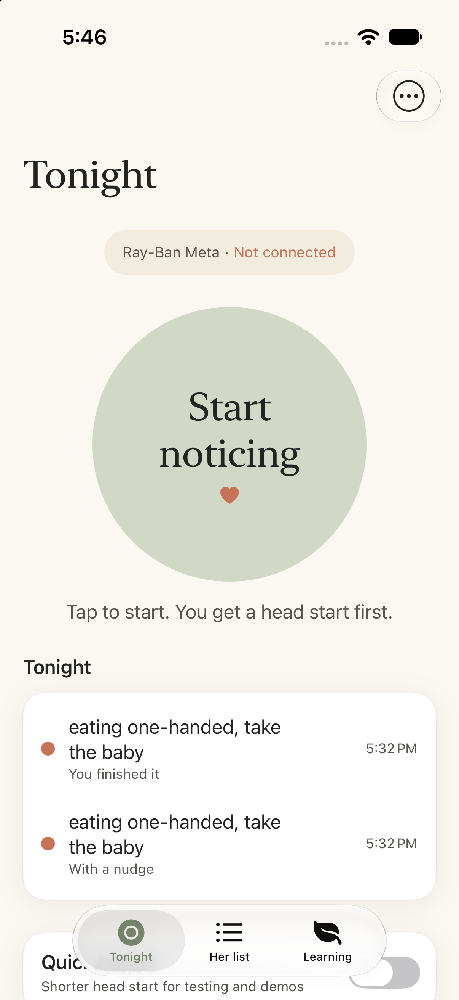
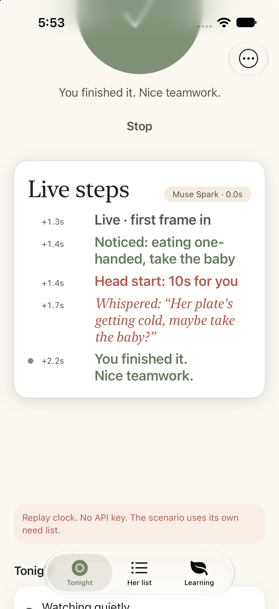
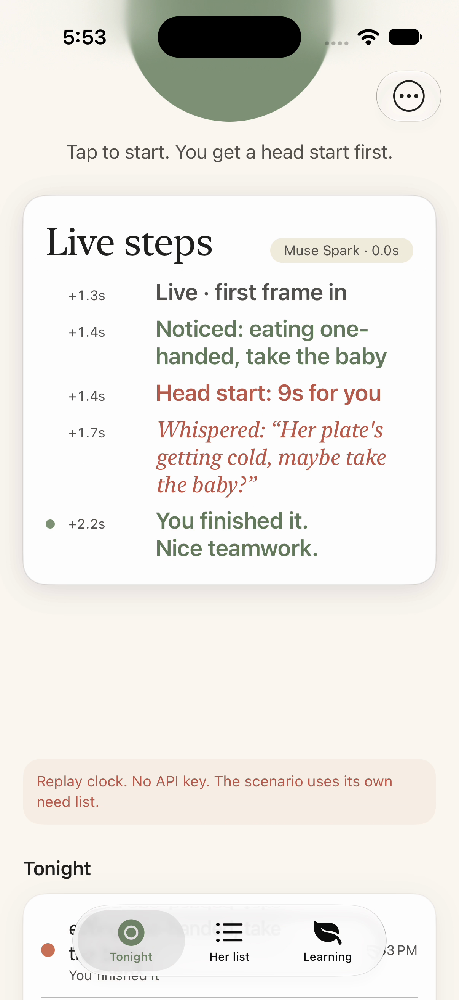
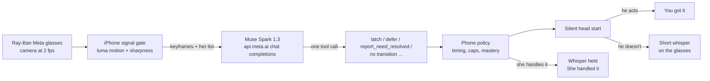

# Noticer

**A quiet teammate. Her list, her words.**

Noticer helps a new dad notice what his partner needs before she has to ask. She writes her own list of needs in her own words. He wears Ray-Ban Meta glasses. When one of her needs is open, he first gets a silent head start to notice it himself. Only if he doesn't act does he hear a short whispered cue. If she handles it herself, Noticer holds the whisper and records "She handled it". As he learns, the cues fade.

A solo entry to the Meta Global AI Developer Hackathon, Indie track ("Build for Your World"). Built Oct 27 to Nov 4, 2026 (first commit Oct 27, 2026), and submitted Nov 4, 2026.

## Screenshots

<!-- Screenshot PNGs (onboarding, tonight, head-start, she-handled-it, summary) are not in the repo yet; see docs/screenshots/README.md. Re-add the table once they are committed. -->





[Ten-second demo clip](docs/demo-strip/demo-clip10.mp4)

## How it works



1. **Her list.** Mom writes a few everyday needs in her own words (for example, keep water on the table while she nurses, or take the baby so she can eat).
2. **Glasses.** The Meta Wearables Device Access Toolkit streams first-person camera frames from Ray-Ban Meta glasses to the iPhone at 2 fps.
3. **Signal gate.** On the phone, `SignalGate` uses luma motion and Laplacian sharpness (no on-device person or hand model) to decide which frames are worth keeping. With nothing open it admits a frame every 2 s (quick timing) or 8 s (standard timing), plus motion edges. With a need open it admits every 4 s or on change.
4. **Muse Spark.** The need engine sends a short keyframe strip (2 keyframes when scouting, up to 3 to confirm or recheck; each JPEG resized on the phone to 896 px on the long edge at quality 0.70) and her list to Muse Spark 1.3 (`muse-spark-1.3`), which runs in Meta's cloud at `api.meta.ai`, not on the phone or glasses. The model answers with one tool call, such as `latch_need_hypothesis`, `defer_cue_wearer_busy`, `report_need_resolved`, or `report_no_transition`, and fills scene fields like `partner_in_view` and `wearer_hands_occupied`.
5. **Phone policy.** A tool call is a request, not a command. The phone owns the head start, rate limits, session and call caps, and credit. If he catches the need himself, that counts toward mastery. If he doesn't, he hears one short whisper through the glasses speaker. If the model calls `report_need_resolved` with resolution `resolved_by_partner` (she resolved it), the whisper is held, the log says "She handled it", and he gets no credit.
6. **Learning.** The Learning tab tracks each need. Self-catches raise mastery, the head start grows (standard timing starts at 90 s, capped at 120 s; quick timing starts at 10 s), and the cue goes quiet for needs he reliably catches.

## Privacy

- **Frames stay in memory.** Nothing in the signal gate or the camera seam writes a frame to disk. Camera frames are not saved.
- **What leaves the phone.** In live mode, selected keyframes (JPEG, resized on the phone) and the need descriptions are sent to Meta's API to check the scene. Replay sends nothing.
- **What stays on the phone.** Her list, progress, and the activity log.
- **No microphone.** The app does not request microphone permission.
- **SDK telemetry off.** The Device Access Toolkit's analytics and crash reporting are opted out in `Info.plist` (`MWDAT > Analytics > OptOut` and `MWDAT > CrashReporting > OptOut`).
- **The key is not in the repo.** On the phone the Meta API key is saved to the Keychain. The command-line tools read `META_API_KEY` from the environment. The key is not logged.

Or copy `.env.example` to `.env`, fill in the key, and run `set -a; source .env; set +a`.

## Quick start (iPhone)

Full steps, including signing with a free Apple ID and enabling glasses developer mode, are in [ios/SETUP.md](ios/SETUP.md).

1. **Build.** On a Mac with Xcode:
   ```sh
   brew install xcodegen
   cd ios
   xcodegen generate
   open Noticer.xcodeproj
   ```
   Select your Personal Team under Signing & Capabilities, choose your iPhone, and press Run.
2. **Add a Meta API key.** In the app's Settings, paste your key and tap **Save to Keychain**. Without a key, live mode does not open a connection, but Replay still works.
3. **Pair glasses.** In onboarding, connect Ray-Ban Meta glasses through the Meta AI app, or tap **Continue without glasses** to explore the app and Replay.
4. **Start noticing.** On the Tonight tab, tap the circle.

## Replay without a key

No glasses and no network; replay reads no API key. From the repo root:

```sh
swift test
swift run noticer-replay --list
swift run noticer-replay
swift run noticer-replay --scenario water-table-whisper
swift run noticer-replay --timing quick
```

`noticer-replay` plays the sessions in `fixtures/scenarios` through the same `SessionPipeline` the phone uses: replay frames, a scripted signal gate, `NeedEngine`, recorded model verdicts, and a recording cue speaker. The scenario clock jumps, so a head start does not take wall-clock time. It exits 0 when every scenario matches its expected outcome.

The demo scenarios use the need "Keep water on the dining table when I am sitting there" and run on quick timing (a 10 s head start):

- `water-table-whisper`: he misses it, and one whisper fires after the head start.
- `water-table-self-catch`: he puts the water down first. He gets credit and no cue plays.
- `water-table-she-handled-it`: she gets her own water during the head start. The need closes as handled by her, with no credit and no cue.
- `water-table-whisper-she-handled-it`: he misses it and the whisper fires, then she gets the water herself. The need closes as "She handled it", with no credit.

In these fixtures the model's `report_need_resolved` tool call carries `"resolution": "resolved_by_partner"`; that is a field value, not a separate tool.

The older `take-baby-whisper`, `take-baby-self-catch`, and `refill-water-whisper` scenarios still run on standard timing (90 s head start). That makes 7 scenarios in all. Passing `--timing` overrides each scenario's own timing.

The iPhone app has a Replay screen (from the top-right menu) that runs the same scenarios. Each scenario plays in about 15 s, compressed: it shows the opening frame, then every Live steps row and phase change as its own beat, skips quiet stretches (the timer jumps between beats), and ends by holding the outcome, "You got it" or "She handled it". Picking a scenario always starts paused at 0:00, and pressing Play at the end restarts it. The water-table scenarios are listed first, and the rest appear under "Older scenarios". `fixtures/clips/` may be empty. A clip there is optional.

**Recorded frames.** Water-table scenarios can show the real glasses view. Put frames in `fixtures/keyframes/water-table/` (`0001.jpg`, … in time order), with an optional `verdicts.json` that maps each file name to its time (`{"0007.jpg": {"t": 4.0}}`). Then run:

```sh
ios/make-replay-scenario.sh
```

The script shrinks each frame to 640 px on the long edge and about 40 KB, strips EXIF and GPS (this needs Python with Pillow; the `sips` fallback may leave EXIF in place), and writes the `frames` list into the `water-table-*.json` scenario files. Replay then shows the frame at the playhead in a card labelled "Glasses view (recorded)". A scenario without frames shows the orb. The water-table scenario files already list their frames (`water-table/0001.jpg`, …), but the JPEGs are gitignored and not in the repo, so until you add them the app hides those scenarios and shows only the older ones.

<!-- Screenshot placeholder: Replay with "Glasses view (recorded)". Add it under docs/screenshots/ when available. -->

## Architecture

```
Package.swift                     Swift package (builds and tests on Linux)
Sources/NoticerCore/              shared types, SignalGate, TimingProfile, limits
Sources/NoticerCore/Engine/       NeedEngine, KeyframeBuffer, MasteryMath
Sources/NoticerAgent/             Muse Spark client, ToolCatalog, DeveloperPrompt, HardCapGate, record and replay
Sources/NoticerAgent/GateG0Main/  noticer-gate-g0, one live check against Muse Spark
Sources/NoticerPipeline/          SessionPipeline, replay scenarios
Sources/NoticerPipeline/ReplayMain/  noticer-replay
Tests/                            NoticerCoreTests, NoticerAgentTests, NoticerPipelineTests
ios/project.yml                   XcodeGen spec for the iPhone app
ios/Noticer/Screens/              Onboarding, Tonight (LiveSessionView), Her list (MomsListView), Learning, Replay
ios/Noticer/Seams/                DATFrameSource, GlassesCueSpeaker, ModelKeyStore, AgentSeam
ios/Noticer/Signal/               LumaExtractor, SignalFrameGate
ios/Noticer/Support/FrameJPEG.swift  in-memory JPEG encoding for uploads (896 px, q0.70)
fixtures/scenarios/               end-to-end replay sessions
fixtures/model-responses/         recorded model turns
fixtures/keyframes/               scout keyframes; water-table/ for your own gitignored stills
fixtures/clips/                   optional POV clips (may be empty)
ios/make-replay-scenario.sh       wires recorded stills into the water-table scenarios
.github/workflows/swift-test.yml  CI: swift test on Ubuntu
```

`NoticerCore` has no Apple-framework or network dependency. `NoticerAgent` depends on it, `NoticerPipeline` on both, and the iOS app on all three plus the Device Access Toolkit. CI runs `swift test` and builds both command-line tools on Ubuntu; the iOS target is built in Xcode.

## Meta technology used

- **Muse Spark 1.3** (`muse-spark-1.3`) through `POST https://api.meta.ai/v1/chat/completions`, with tool calling (`tool_choice: auto`, `parallel_tool_calls: false`).
- **Meta Wearables Device Access Toolkit iOS SDK 1.0.1** (`MWDATCore`, `MWDATCamera`), pinned in `ios/project.yml`, for the camera stream from the glasses.
- **Ray-Ban Meta glasses**, for first-person video and the whispered cue through the glasses speaker.
- **Muse Code**, which implemented the project (see Credits).

## Not built yet / limitations

- Only the Meta API backend is implemented. Selecting the Baseten backend throws before any request is built.
- No on-device vision model. The signal gate is luma motion and sharpness only, so visitor pausing is manual.
- No Mock Device Kit integration. Live mode needs real glasses; without them, use Replay.
- No frame capture or clip recording from the glasses.
- Replay stills for the water-table scenarios are not committed; add your own (see Replay).
- The iOS target is not built in CI.
- Tuned for a few household needs and a short evening session, with a per-session cap on model calls.

## Credits

Built solo by [Indrajeet Kumar](https://github.com/indrajeet-kr). The author wrote the specs and reviewed every pull request, and Muse Code implemented them.

Thanks to Meta for Muse Spark, the Wearables Device Access Toolkit, and Ray-Ban Meta glasses.

See [CONTRIBUTING.md](CONTRIBUTING.md) for module ownership. Licensed under [MIT](LICENSE).
